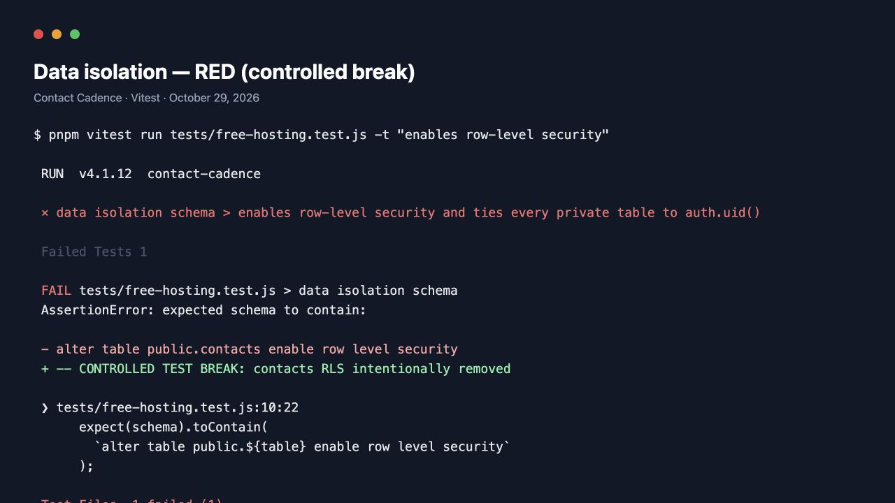
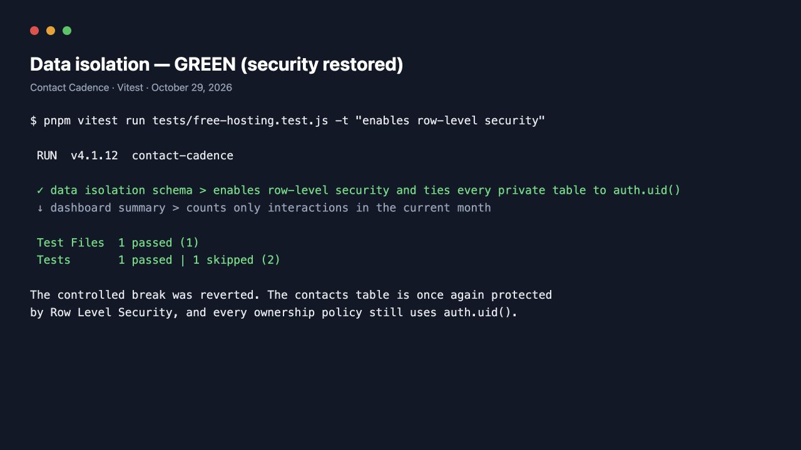
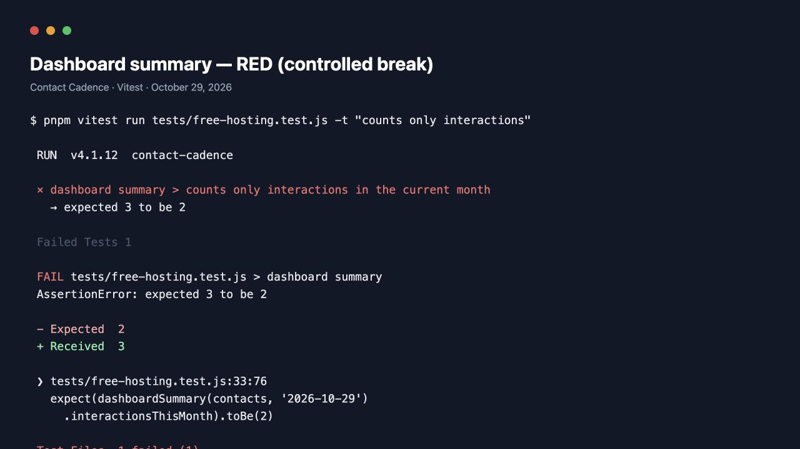
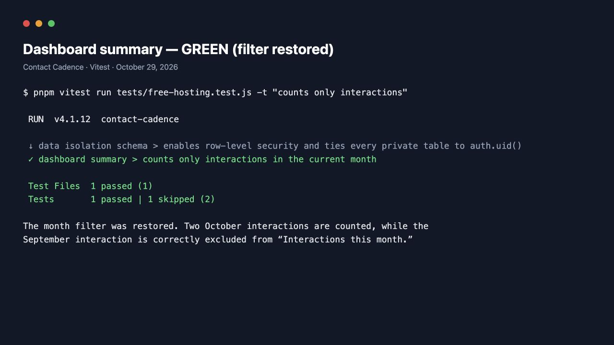

# Required Test Evidence

## Data isolation

**Plain-English explanation:** This test reads the production database schema and verifies that Row Level Security is enabled on every private table. It also checks that the ownership policies use `auth.uid()`, the ID of the signed-in Supabase user. Together, these rules prevent User B from reading User A's contacts and make a direct request for another user's contact behave as “not found.”

**Red, then green:** For the controlled break, the `contacts` RLS-enablement statement was temporarily removed from the local schema file. The test failed because that table was no longer protected. The statement was immediately restored, and the same test passed. The broken schema was never applied to Supabase or committed.

**Deployed acceptance test:** Two temporary accounts were created against the deployed Supabase project. User A created a contact; User B's list remained empty, and User A's direct contact URL displayed “Contact not found” for User B. The temporary records and accounts were removed after the check.

**What would break it:** Disabling RLS or replacing an ownership policy with `using (true)` could expose another user's data.

## Dashboard summary

**Plain-English explanation:** The test supplies two interactions in October 2026 and one in September 2026. It requests the dashboard summary for October 29 and checks that “Interactions this month” equals `2`, proving that the prior-month interaction is excluded.

**Red, then green:** For the controlled break, the month filter was temporarily removed so all three interactions were counted. The test failed with “expected 3 to be 2.” The filter was restored immediately, and the same test passed.

**What would break it:** Removing the year/month comparison would count all three interactions and fail the test.
